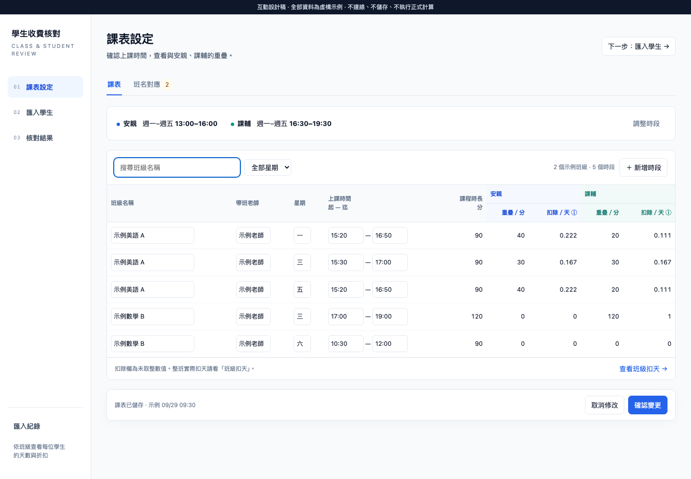
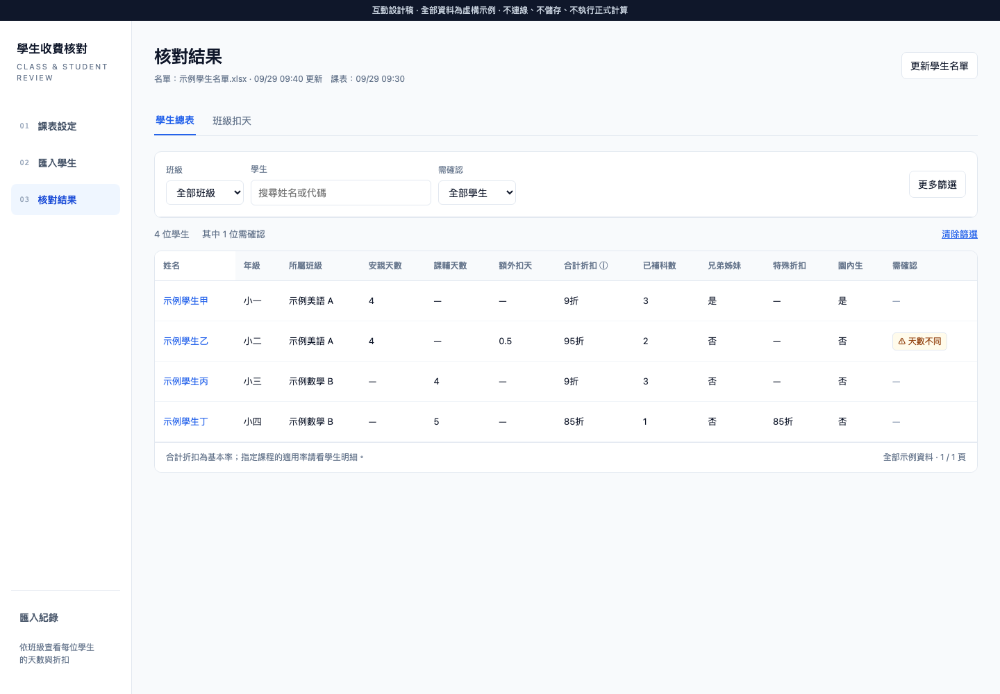

# UI 設計交付

設計基準：2026-09-29，origin/main 25e0ebf。產品規格與實作順序見[09](../09-ui-workflow-redesign-spec.md)、[10](../10-ui-workflow-redesign-plan.md)。

用瀏覽器開啟 [ui-workflow-prototype.html](ui-workflow-prototype.html)，不需npm／服務／網路。此頁為合成資料的互動示意：可切課表／匯入／結果、班名對應、篩選學生、展開班級扣天與明細、查看確認視窗。時間欄可編輯但不重算；匯入／儲存僅演示，不會讀寫ERP或產品DB。完整功能契約由09定義，不以mock是否已實作某動作決定範圍。

## 本次驗證

- 實際唯讀開啟使用者localhost四個頁面，查看標題、控制項與截圖，對照source。未提交上傳／設定／啟用。
- Playwright驗設計稿：導航、5列課表及班名篩選、確認dialog及Esc、班級扣天展開、學生篩選／清除、匯入預覽→完成、無JS錯誤。
- 1440／1280／1024／768寬度無整頁水平溢出；寬表允許表內捲動。人工檢視1440課表與學生總表截圖。未完成正式產品a11y或全瀏覽器驗收。
- 文件表格與相對連結、git diff --check通過。未執行或宣稱新增UI的產品unit／integration／E2E已通過；10是後續實作驗收計畫。

以上圖片均取自合成示意，不含使用者真實學生／老師資料。現有UI的私人截圖僅留本機/tmp，不提交repo。
