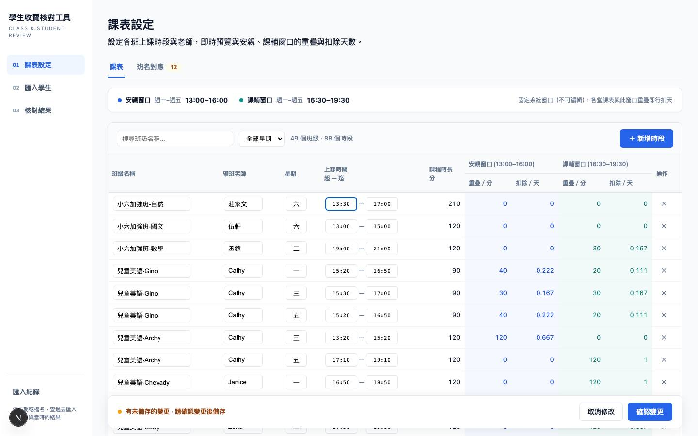
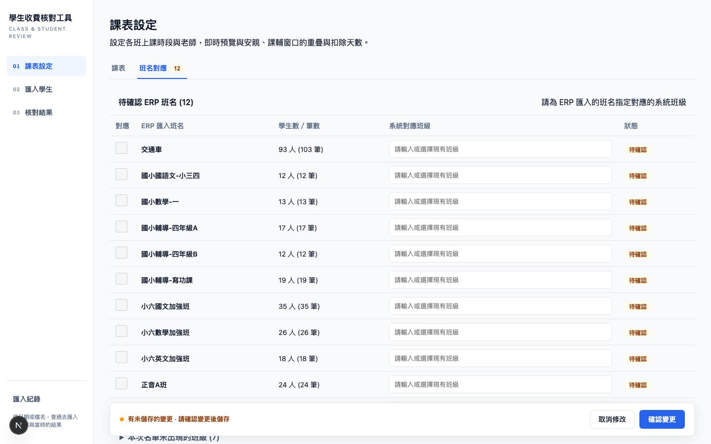
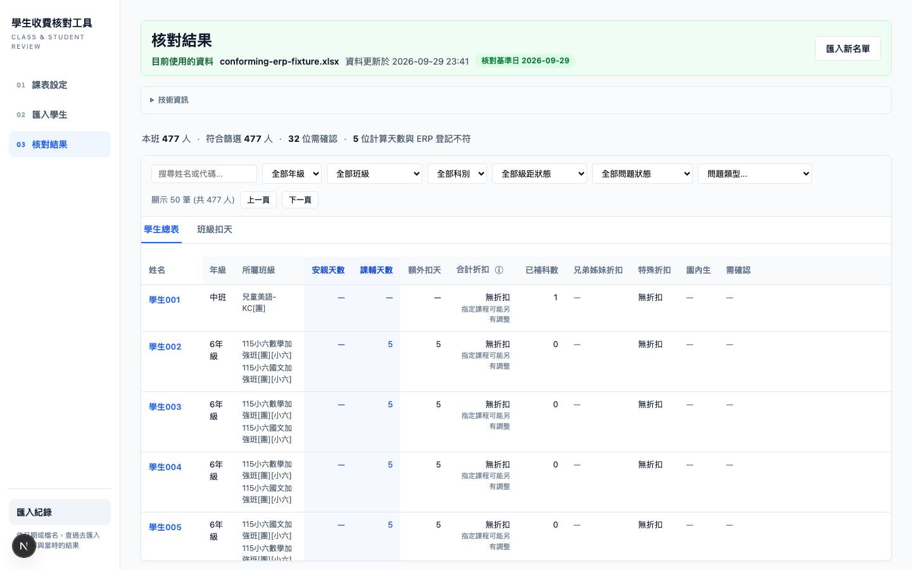
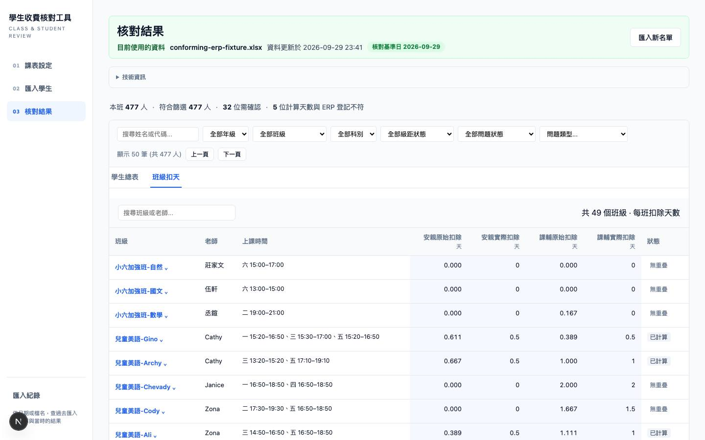
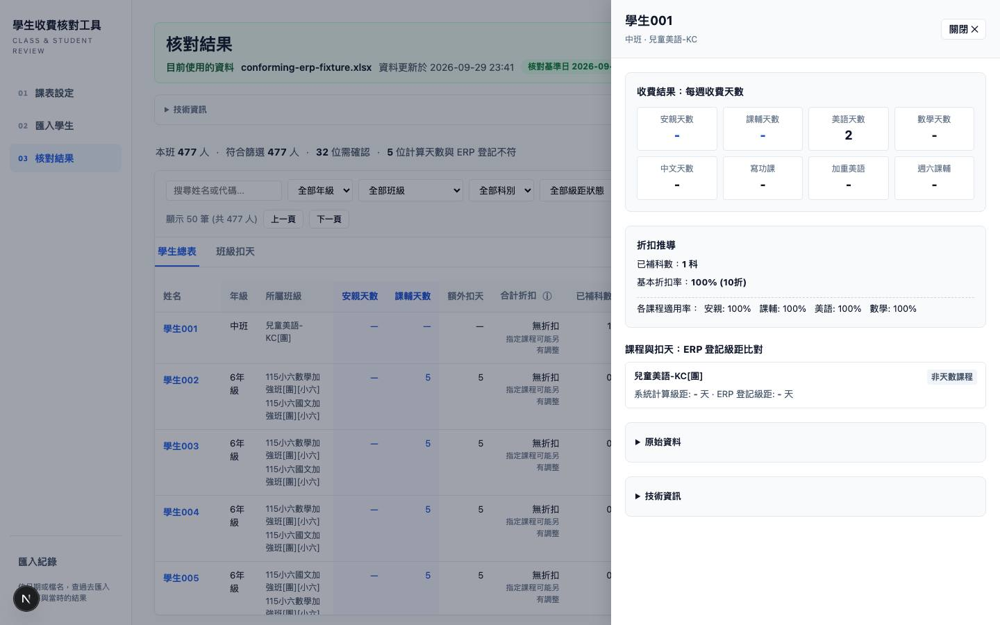
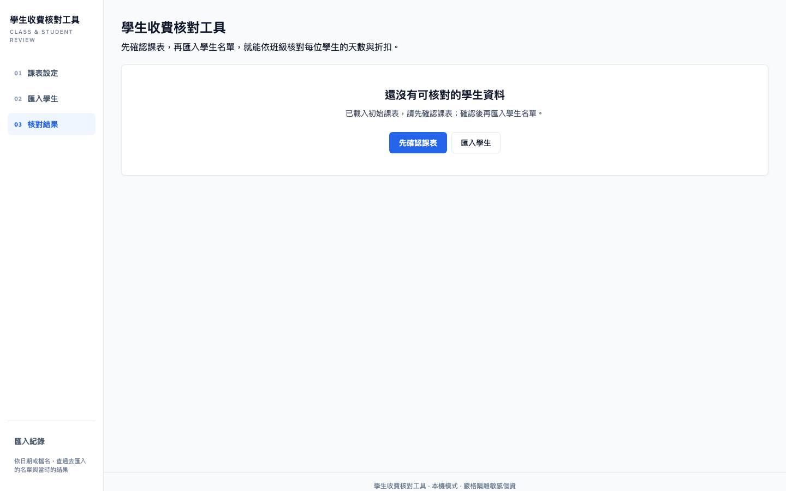
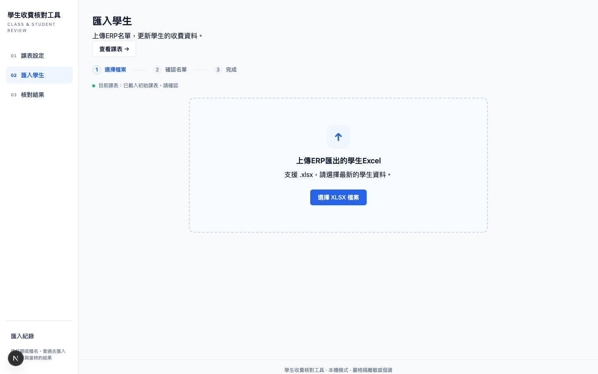
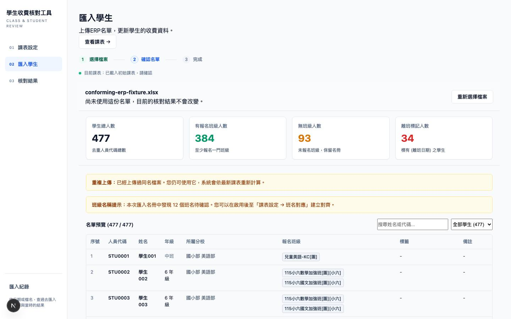
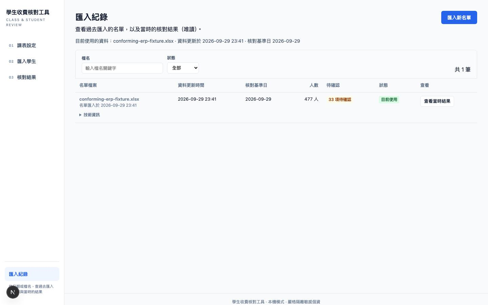
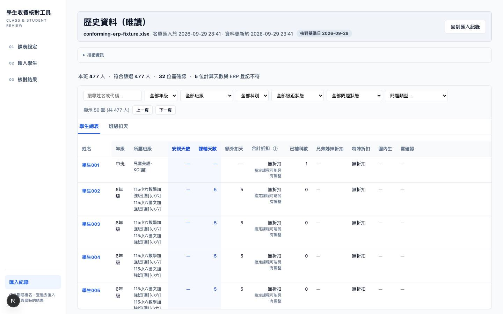

# UI 重設驗收報告（Plan 10 R5）

本報告是「先課表、後匯入、再核對」UI 重設（[06 D33](../06-handoff-decisions.md)、[09](../09-ui-workflow-redesign-spec.md)、[10](../10-ui-workflow-redesign-plan.md)）的最後一批（R5）驗收與交付報告。UX 驗收矩陣正本在 [04 §8](../04-tdd-acceptance.md)。

> **讀法**：第 3 節逐條列 UX01–UX24 的結果與證據；第 10 節列未完成項與已知限制。**沒有「全套通過」這種整體宣稱**——每一條各自成立，有缺口的條目都在「缺口」欄寫明。

---

## 0. 文件資訊

| 項目 | 內容 |
|---|---|
| 日期 | 2026-09-29 |
| Repo／分支 | `cheerc/student-billing`／`chore/r5-history-a11y-acceptance-report`（base：origin/main `743dda3`，R4 merge 點） |
| 驗證的程式碼版本 | `8dc18f8cf61ee0c3a92dd66679da0e23e9bda1a2`。本報告與截圖是其後的純文件 commit，不含程式碼變更 |
| 環境 | Node.js v24.21.0，Apple M1 x 8／16 GB，macOS（darwin arm64），Chromium（Playwright） |
| 資料 | **全部使用合成／匿名資料**：`web/tests/fixtures/conforming-erp-fixture.xlsx`（477 人，保形匿名）。沒有使用真實名單，見第 7、10 節 |
| 不含 | N-a 後續任務（-48）、domain 首個數學／美語後續任務（-47）、R2–R4 功能擴張、CI gate |

---

## 1. 結果一覽

| 結果 | 條數 | 條目 |
|---|---|---|
| 通過 | 18 | UX01–UX08、UX10、UX11、UX13、UX14、UX17、UX18、UX19、UX22、UX23、UX24 |
| 通過（有缺口） | 6 | UX09、UX12、UX15、UX16、UX20、UX21（缺口逐條寫在第 3 節） |
| 未完成 | 0 | — |
| 不適用 | 0 | — |

「通過（有缺口）」的意思是：矩陣要求的行為已有自動化證據且通過，但有一部分（列在缺口欄）沒有對應證據，**不是**已驗證。

本批驗證結果（程式碼版本 `8dc18f8`）：

| 項目 | 結果 |
|---|---|
| `tsc --noEmit` | exit 0 |
| `eslint .` | exit 0 |
| `vitest run` | 60 個檔案通過、1 個 skipped；440 個測試通過、1 個 skipped |
| `npm run build`（production build） | exit 0 |
| `npm run test:e2e:isolated`（完整隔離 E2E） | 13 個 spec 檔、31 個測試全部通過 |
| 真實資料庫指紋（前後對比） | 不變（第 7 節） |
| 3000／3100 埠監聽（驗證結束時） | 0 個 |
| `git diff --check` | 乾淨 |
| domain／migration／依賴（`web/src/domain`、migrations、`package.json`／lock）改動 | 0 個檔案 |

---

## 2. 各 PR 的 commit 對照

全部以 squash merge 進 main。

| 批次 | PR | main 上的 commit | 內容 | 主要對應 UX |
|---|---|---|---|---|
| 設計 | #22、#23 | `66d6371`、`79bf8ad` | UI 重設 spec／plan／互動 mockup；rework 修正（B1–B6、N1–N7） | — |
| R0 | #27（issue #25） | `a959beb` | 隔離 E2E 執行器＋守衛，移除 recovery-ui 刪除 DB 的 hook | 隔離基礎 |
| R1a | #26（issue #24）、#28 | `d5bc4f9`、`dd9f08d` | activate 採最新已儲存設定；preview／apply 的 import 由 server 依 `active_state` 決定 | UX02、UX03、UX04（importId）、UX18、UX22 |
| R1b | #29 | `35c8bde` | calculate／deductions read model、settings_only、migration 0006、空時段語意 | UX01、UX04–UX08、UX17–UX19、UX23、UX24 |
| R2 | #30 | `6a00901` | 展示一：課表主畫面、即時重疊計算、先課表後匯入 | UX01–UX10、UX14–UX16、UX24 |
| R3 | #31 | `8bf9b42` | 匯入頁一次完成使用名單（三態流程＋頁內啟用） | UX09–UX12、UX19、UX22 |
| R4 | #32 | `743dda3` | 展示二：核對結果頁（學生總表 12 欄＋班級扣天）；異動以計算結果判定 | UX05–UX08、UX11–UX16、UX20、UX21 |
| **R5（本 PR）** | 待開 | 待 merge | 匯入紀錄頁、文案／a11y／響應式稽核、驗收報告 | UX15、UX16、UX20、UX21 |

R5 分支上的 commit（由舊到新）：

| commit | 內容 |
|---|---|
| `9ab08d4` | test：匯入紀錄頁與歷史唯讀檢視（RED） |
| `119659a` | feat：匯入紀錄頁四態與歷史唯讀檢視；「待設定班級」改動態判斷（GREEN） |
| `9af9720` | test(e2e)：歷史頁 E2E、待設定班級改驗兩情境、橫幅文案更新 |
| `2f075b6` | feat：文案全頁掃描與首頁去技術化（09 §2／§7） |
| `eef53a5` | feat：可及性稽核與修正（09 §6） |
| `ec9d008` | feat：UX20 響應式量測與修正 |
| `649c3b7` | test(e2e)：補 UX08 舊回應晚到、UX09 取消草稿的瀏覽器證據；響應式量測納入空狀態與抽屜 |
| `7438933` | fix(ui)：視覺檢視發現的六項修正（第 9 節） |
| `8dc18f8` | fix(imports)：預覽的待確認班名與課表設定同源 |
| （其後） | docs：本報告、截圖與量測 JSON |

---

## 3. UX01–UX24 逐條結果

**圖例**：整合＝真 SQLite 的 integration 測試；E2E＝Playwright 隔離執行（`tests/e2e/…`）；單元＝vitest 單元／元件（`renderToStaticMarkup`）。證據檔案皆在 `web/tests/` 下。

| UX | 結果 | 證據 | 缺口／備註 |
|---|---|---|---|
| UX01 空 DB 先改課表→確認→儲存→重啟 | 通過 | 整合 `settings-only.test.ts`（UX01：儲存後關閉並重開 DB，設定與 revision 保留、run 仍為 null）；E2E `schedule-grid-workflow.spec.ts`（空 DB 進 `/settings`→編輯時段→確認變更→儲存課表）；單元 `settings-schedule-grid-ui.test.ts` | — |
| UX02 只有 ready 批次，儲存課表再 activate；client 傳非 active／null importId | 通過 | 整合 `settings-import-server-decided.test.ts`（client importId 被拒、`active_state` 不變）；`settings-only.test.ts`（儲存不啟用 ready 批次，之後 activate 的 run.scheduleVersionId＝最新已儲存設定 id） | — |
| UX03 有 active 改時段：取消／失敗／成功 | 通過 | 整合 `settings-only.test.ts`（取消與失敗時 active 不變；成功時設定與新 run 原子切換）；E2E `settings-preview-apply.spec.ts`（成功）、`settings-cancel.spec.ts`（取消） | 「失敗」情境僅整合層 |
| UX04 settings_only 儲存與另一 tab activate 競爭；importId 與 server 決定值不符 | 通過 | 整合 `settings-only.test.ts`（一成功另一 409；同 key／body 重送回原結果）、`settings-import-server-decided.test.ts`（不符被拒、不啟用任何批次） | — |
| UX05 週一 15:20–16:50，v2 預設窗口 | 通過 | 單元 `schedule-preview.test.ts`（課長 90、安親 40 分／40÷180、課輔 20 分）；E2E `schedule-stale-response.spec.ts`（畫面顯示 40）；展示一截圖（兒童美語-Gino 週一：40／0.222、20／0.111） | — |
| UX06 同班多堂先合計再取整 | 通過 | 單元 `schedule-preview.test.ts`（安親 40+30+40＝110 分→0.5；課輔 20+30+20＝70 分→0.5）；展示二「班級扣天」截圖（Gino：0.611→0.5、0.389→0.5，與矩陣手算相同） | — |
| UX07 週六／未知星期／缺起迄／共用窗口／停用 | 通過 | 單元 `schedule-preview.test.ts`、`settings-schedule-grid-ui.test.ts`（含 R5 新增：計算結果未回來時重疊欄顯示「—」而非 0，確實無重疊才顯示 0） | — |
| UX08 改班名／老師／星期／起迄，舊回應晚到 | 通過 | 整合 `settings-read-model-api.test.ts`（requestKey 原樣回傳、任一欄位改動使 draftHash 改變）；**R5 新增** E2E `schedule-stale-response.spec.ts`：攔截 calculate、扣住舊請求讓新請求先回，再放行舊回應，畫面仍為新結果。變異檢查：拿掉前端 requestKey 保護後測試變紅，已還原 | — |
| UX09 改散同班名、刪列、停班、alias 失效 | 通過（有缺口） | 單元 `settings-grid-rename-delete.test.ts`（改散偵測、單列刪除）；E2E `settings-preview-apply.spec.ts`（班名對應→確認變更→影響預覽→儲存）；**R5 新增** E2E `settings-cancel.spec.ts`（改動→取消→還原，重新整理後仍為原值＝沒有提交） | **缺口**：D28 改散警告在確認視窗的顯示沒有瀏覽器層或元件層的獨立斷言（偵測函式有單元測試，畫面顯示只有程式碼審視）；停班、alias 失效的提示同樣無專測 |
| UX10 新 ERP／新設定產生差集 | 通過 | 整合 `candidate-aliases.test.ts` 等（D32-C 動態候選、去重人數、不自動批准）；E2E `settings-preview-apply.spec.ts`（數學一→一A，影響 13 人／18 筆差異）；單元 `settings-schedule-grid-ui.test.ts`（MappingPanel） | — |
| UX11 上傳→預覽→使用→核對；缺標頭錯誤 | 通過 | E2E `imports.spec.ts`、`active-run.spec.ts`、`recovery-ui.spec.ts`（單頁完成，真實人數與日期）；整合 `erp-reader.test.ts` I03（缺必要標頭拒絕）、`t06-recovery.test.ts` I09（中途故障舊 run 不變）、`activate-run.test.ts`（CAS 409 資料不變）；E2E `a11y.spec.ts`（上傳格式不對→白話錯誤以 role=alert 呈現） | — |
| UX12 同檔／過期／版本變更 | 通過（有缺口） | 整合 `api-import-activate-batch-id.test.ts`（同檔判重、不重複學生）、`activate-run.test.ts`（冪等、CAS 409）、`settings-preview-ttl.test.ts`（預覽過期）；E2E `imports.spec.ts`（重複上傳提示不阻擋）；R5 新增統一訊息 `ACTIVATE_CONFLICT_MESSAGE` | **缺口**：「過期」「版本已變更」的畫面訊息（`settings-editor.tsx`、`roster-view.tsx`、`imports-workflow.tsx`）只有程式碼審視，沒有觸發這兩種狀態的瀏覽器測試 |
| UX13 選班→搜尋→更多篩選→明細→返回 | 通過 | E2E `active-run.spec.ts`（搜尋／需確認篩選後人數與清單一致、「本班 N 人」不受其他條件收斂、q 不進 URL）；`a11y.spec.ts`（關閉明細後焦點回到觸發列） | — |
| UX14 八欄 null／false／0／特殊率／不適用 | 通過 | 單元 `summary-table-columns.test.ts`（12 欄順序、0／null／不適用／未設定分開顯示、合計折扣與本班率分開）；整合 `results-page-stats-scope.test.ts`；E2E `active-run.spec.ts`（八欄可達、姓名 sticky 由 `responsive.spec.ts` 量測） | — |
| UX15 級距 match 但有 issue，未知 issue code | 通過（有缺口） | E2E `active-run.spec.ts`、`recovery-ui.spec.ts`（吻合＋待確認含 SCHEDULE_NOT_FOUND，5 筆級距差異照實呈現，不硬限 13 人）；單元 `summary-table-columns.test.ts`（無警告時不宣告已對帳正確）；文案掃描將問題類型短標列為 UX15 明定保留的例外 | **缺口**：未知 issue code 沒有專測；現況是原樣顯示代碼短標（`summary-table.tsx`），可在明細抽屜查原因，但這條路徑無自動化斷言 |
| UX16 tab／focus／click tooltip，drawer／modal Esc | 通過（有缺口） | **R5 新增** E2E `a11y.spec.ts`（9 個測試）：抽屜與確認視窗的名稱／焦點進入／Tab 不逸出／Esc／關閉回觸發點；WAI-ARIA 頁籤（核對結果、課表設定）；tooltip 的 hover／focus／click 皆可開、Esc 可關；錯誤 role=alert；焦點可見 | **缺口**：沒有用螢幕閱讀器實測（見第 6 節）；稽核腳本是自寫，不是 axe |
| UX17 舊 DB migration／故障／備份還原 | 通過 | 整合 `migration-0006-nullable.test.ts`（table rebuild 後逐列保留含 `expires_at`、`response_payload`）；`t06-recovery.test.ts`（I09 故障不變、I12 重開保留）；`web/scripts/backup-restore.ts` | — |
| UX18 相同 input 計算前後比對 | 通過 | 整合 `calculation-invariance-ux18.test.ts` 對 `fixtures/ux18-seed-deductions-golden.json`（全量 seed 草稿逐班值與改動前相同；API 路徑同）；`activate-run.test.ts`（erp-tag-v1／v2 在 seed 基準下 477 筆一致）。R5 未改 `web/src/domain` | — |
| UX19 多次 calculate POST／deductions GET | 通過 | 整合 `settings-read-model-api.test.ts`（各表列數與內容、`active_state` 不變，回應無學生個資）；R5 另有 `history-view.test.ts`：查看歷史前後 `active_state`、run、設定版本數不變 | — |
| UX20 1440×900、1280×800、1024×768、768 寬 | 通過（有缺口） | **R5** E2E `responsive.spec.ts`：4 尺寸 × 11 頁＝44 個量測，全部通過（第 5 節）。方法為**自動量測＋實作者視覺檢視** | **缺口**：未經 operator 人工驗收；768 寬只量了 768×1024（直式）；截圖為 dev 模式（見第 10 節） |
| UX21 歷史／空篩選／loading／失敗 | 通過（有缺口） | **R5** E2E `history.spec.ts`（5 個）：空狀態、有資料（目前使用／歷史資料／尚未使用）、空篩選可清除、唯讀歷史檢視、找不到紀錄；`recovery-ui.spec.ts`；整合 `history-view.test.ts`（快照不存在→明示「資料不足，無法重建」且不改用最新課表補算；診斷軌 run 不提供班級扣天）；單元 `history-ui.test.ts` | **缺口**：loading／失敗兩態只有元件層測試（`loading.tsx`、`error.tsx` 渲染），沒有瀏覽器 E2E；「資料不足」訊息在瀏覽器層沒有 E2E（只有整合層與元件層） |
| UX22 已 apply 設定→匯入新批次→activate；client 傳不同 scheduleVersionId | 通過 | 整合 `activate-saved-settings.test.ts`（run.scheduleVersionId＝最新已儲存設定 id，天數與班名對應採該設定；route 不轉交 client scheduleVersionId；尚無設定時為 seed-v250922） | — |
| UX23 刪光某班全部時段／清空所有列時間／移除整班 | 通過 | 整合 `schedule-empty-semantics.test.ts`（12 個：無時段→不扣天＋`schedule_empty`；不在該版本→`schedule_not_found`；皆不退回 seed）；單元 `schedule-preview.test.ts` | — |
| UX24 開課表頁；送出 careWindows 與 ruleSet 不同的 draft | 通過 | 單元 `settings-schedule-grid-ui.test.ts`（WindowSummary 唯讀、無輸入框）；E2E `schedule-grid-workflow.spec.ts`；整合 `settings-read-model-api.test.ts`（不同 careWindows→400 `INVALID_DRAFT`；calculate 回應 windows＝ruleSet） | — |

---

## 4. 三次展示

截圖皆為 **1440×900、Next.js dev 模式、合成 fixture**（畫面左下角圓形「N」是 Next.js 開發模式的指示器，production build 沒有）。所有尺寸的完整截圖見 [`ui-redesign-acceptance/screens/`](ui-redesign-acceptance/screens/)（44 張，檔名 `<寬x高>-<頁面>.jpg`）。

### 展示一：課表主畫面（先課表、後匯入）

- 空資料庫也能直接進 `/settings` 編輯課表（不再要求先匯入名單）；上方是**唯讀**的安親窗口 13:00–16:00、課輔窗口 16:30–19:30（D33：窗口固定，沒有輸入框）。
- 每一列右側是即時計算值。截圖中兒童美語-Gino 週一 15:20–16:50：課程時長 90 分，安親重疊 40 分＝40÷180＝0.222 天，課輔重疊 20 分＝0.111 天，與 UX05 的手算一致。
- 第一列被改成 13:30，底部操作列出現「有未儲存的變更」，可「取消修改」或「確認變更」（確認才開啟影響預覽視窗；沒有名單時主按鈕是「儲存課表」）。

- 「班名對應」頁籤標示待確認的 ERP 班名（12 個，琥珀色＝需確認），每列可勾選並指定對應的系統班級。

### 展示二：核對結果頁

- 頂部橫幅標明「目前使用的資料」＝檔名、資料更新時間、核對基準日；Run ID 等技術資訊收在「技術資訊」摺疊區。
- 人數行：本班 477 人、符合篩選 477 人、32 位需確認、5 位計算天數與 ERP 登記不符（fixture 的照實結果，不是業務目標）。
- 學生總表 12 欄（姓名、年級、所屬班級、安親天數、課輔天數、額外扣天、合計折扣、已補科數、兄弟姊妹折扣、特殊折扣、園內生、需確認）；姓名欄 sticky，「合計折扣」旁的 ⓘ 是可用滑鼠、鍵盤、點擊開啟的說明。

- 「班級扣天」頁籤：49 班，各班安親／課輔的原始扣除與實際扣除（先合計再取整）與狀態。兒童美語-Gino（週一 15:20–16:50、週三 15:30–17:00、週五 15:20–16:50）：安親 110÷180＝0.611→0.5、課輔 70÷180＝0.389→0.5，與 UX06 手算一致。

- 點學生姓名開啟明細：八項每週收費天數、折扣推導、課程與扣天（系統計算級距 vs ERP 登記級距）；「原始資料」「技術資訊」為摺疊區。抽屜開啟時焦點進入、Tab 不逸出、Esc 關閉並回到原列。

### 展示三：完整可交付 UI（依序走過整條流程）

| 步驟 | 截圖 |
|---|---|
| 1. 全新資料庫的首頁：說明沒有資料，主動作「先確認課表」與「匯入學生」 |  |
| 2. 課表設定（展示一，見上） | — |
| 3. 匯入學生：選擇檔案 |  |
| 4. 匯入學生：確認名單（預覽統計、重複上傳提示、待確認班名、名單預覽） |  |
| 5. 「使用這份名單」→ 完成 → 「開始核對」 | 該步驟**沒有截圖**；由 `imports.spec.ts`、`copy-scan.spec.ts` 的流程與斷言覆蓋 |
| 6. 核對結果（展示二，見上） | — |
| 7. 匯入紀錄：目前使用／歷史資料／尚未使用，可依檔名、狀態篩選 |  |
| 8. 歷史檢視：「歷史資料（唯讀）」，讀當時的快照，沒有任何寫入動作 |  |

匯入紀錄的每一列有「技術資訊」摺疊區（Run／批次 ID、課表版本、規則版本、數值政策、工作表、檔案雜湊），日常畫面只看檔名、資料更新時間、核對基準日、人數、待確認項數與狀態。歷史 run 不會套用最新設定；當時的課表快照不存在時，畫面明示「資料不足，無法重建」，不用現行課表補算。

流程走查的自動化證據：`copy-scan.spec.ts` 從全新資料庫依序走過首頁、課表、匯入、使用名單、核對結果、歷史檢視、課表確認視窗，共 24 個頁面狀態，每個狀態都掃描文案。

---

## 5. UX20：四種尺寸的實際量測

**方法（誠實標示）**：這是**自動量測＋實作者視覺檢視**，不是 operator 人工驗收。`web/tests/e2e/responsive.spec.ts` 在 Playwright Chromium 中對 4 個視窗尺寸 × 11 個頁面／狀態逐一量測並斷言；1440×900 的 11 張截圖由實作者逐張檢視，其他尺寸以量測數字為主、抽看截圖（含 768 寬的導覽列與學生總表）。量測 JSON 原檔：[`ui-redesign-acceptance/ux20-results.json`](ui-redesign-acceptance/ux20-results.json)。

斷言項目（任一失敗即測試失敗）：

1. 整頁橫向溢出 ≤ 1px（`documentElement.scrollWidth − innerWidth`）；
2. 寬表只在表內捲動；橫向捲動後姓名欄仍貼在容器左緣（sticky）、縱向捲動後表頭仍貼在容器上緣（sticky）；
3. 課表頁捲到底後，主要內容裡沒有任何互動元素被底部操作列蓋住；
4. 導覽的四個入口在每個尺寸都可見；768 寬收合成頂部橫列且高度 < 120px；
5. 沒有覆蓋大半視窗、卻不是 dialog 的固定定位元素（死遮罩）。

量測結果（每格：整頁橫向溢出｜表格容器 可視寬／內容寬 與是否表內捲動）：

| 頁面／狀態 | 1440×900 | 1280×800 | 1024×768 | 768×1024 |
|---|---|---|---|---|
| 首頁（空狀態） | 0px｜— | 0px｜— | 0px｜— | 0px｜— |
| 匯入紀錄（空狀態） | 0px｜— | 0px｜— | 0px｜— | 0px｜— |
| 核對結果｜學生總表 | 0px｜1184/1184 不需捲動 | 0px｜1024/1142 表內捲動 | 0px｜814/1142 表內捲動 | 0px｜734/1142 表內捲動 |
| 核對結果｜學生明細抽屜 | 0px｜1184/1184 不需捲動 | 0px｜1024/1142 表內捲動 | 0px｜814/1142 表內捲動 | 0px｜734/1142 表內捲動 |
| 核對結果｜班級扣天 | 0px｜1184/1184 不需捲動 | 0px｜1024/1024 不需捲動 | 0px｜814/1000 表內捲動 | 0px｜734/1000 表內捲動 |
| 課表設定｜課表（含底部操作列） | 0px｜1184/1184 不需捲動 | 0px｜1024/1024 不需捲動 | 0px｜814/930 表內捲動 | 0px｜734/930 表內捲動 |
| 課表設定｜班名對應 | 0px｜1186/1186 不需捲動 | 0px｜1026/1026 不需捲動 | 0px｜816/816 不需捲動 | 0px｜736/736 不需捲動 |
| 匯入學生｜選擇檔案 | 0px｜— | 0px｜— | 0px｜— | 0px｜— |
| 匯入學生｜確認名單 | 0px｜1144/1144 不需捲動 | 0px｜984/984 不需捲動 | 0px｜774/774 不需捲動 | 0px｜694/694 不需捲動 |
| 匯入紀錄｜有資料 | 0px｜1186/1186 不需捲動 | 0px｜1026/1026 不需捲動 | 0px｜816/816 不需捲動 | 0px｜736/736 不需捲動 |
| 歷史檢視（唯讀） | 0px｜1184/1184 不需捲動 | 0px｜1024/1142 表內捲動 | 0px｜814/1142 表內捲動 | 0px｜734/1142 表內捲動 |

- 44 個量測的整頁橫向溢出**全部為 0px**。
- 1280 以下，學生總表（內容寬 1142）、班級扣天（1000）、課表（930）超出容器時都在**表內捲動**，頁面本身不橫向捲動。
- 768 寬指 768×1024（直式）；沒有量測 768×較矮視窗。

**量測與視覺檢視期間發現並修正的真實缺陷**（詳見第 9 節）：768 寬時「匯入紀錄」導覽入口被隱藏（現在可達）；班名對應表沒有樣式；班級扣天的班名是原生按鈕外觀；側欄提示位置錯置。

---

## 6. 可及性（09 §6）與文案（09 §7）

### 6.1 可及性

本 repo 沒有 axe 依賴，R5 不新增依賴，所以稽核腳本是**自寫**的（`web/tests/e2e/a11y.spec.ts`），逐條對 09 §6。頁面稽核一次跑完 12 個頁面狀態，違規清單須為空，失敗時一次列出（頁面／規則／元素）；另有 8 個針對互動元件的測試。全部通過。

| 09 §6 項目 | 檢查方式 | 結果 |
|---|---|---|
| 一頁一個 h1；main 與具名導覽 landmark；導覽 aria-current | 12 個頁面狀態稽核 | 通過 |
| icon／按鈕／連結／輸入有 accessible name（純符號不算） | 同上 | 通過 |
| 表單控制項有真 label（placeholder／title 不算） | 同上 | 通過 |
| 互動目標 ≥ 24px（行內文字連結依 WCAG 2.5.8 例外；checkbox 以 label 可點範圍計） | 同上 | 通過 |
| 不以符號作唯一狀態（badge 必須有文字） | 同上 | 通過 |
| 資訊不只藏在 hover（不可聚焦元素不得只靠 title 傳達內容） | 同上；5 個「待補」badge 改用 `InfoTip` | 通過 |
| modal／drawer：role=dialog、aria-modal、名稱、焦點進入、Tab 不逸出、Esc、關閉回觸發點 | 明細抽屜、確認變更視窗各一測試 | 通過 |
| 頁籤：role=tab／aria-selected、鍵盤切換、對應 tabpanel | 核對結果與課表設定各一測試 | 通過 |
| tooltip：hover／focus／click 皆可開、Esc 可關 | 「合計折扣說明」一測試 | 通過 |
| 錯誤：role=alert，不只靠顏色 | 上傳格式錯誤一測試 | 通過 |
| 鍵盤焦點有可見指示 | Tab 走過核對結果前 15 個焦點 | 通過 |
| 狀態色語意（09 §4：琥珀＝需確認、綠＝成功／目前使用、灰＝歷史） | 一測試以計算後顏色斷言 | 通過 |

**沒有做的事**：沒有用螢幕閱讀器實測；沒有量測色彩對比（顏色沿用 09 §4 色票，未計算對比值）；自寫稽核不等於 axe。

### 6.2 文案

`web/tests/e2e/copy-scan.spec.ts` 對 24 個頁面狀態取瀏覽器「可見」文字（`body.innerText`，不含收合中的 `
`）加上可見元素的 aria-label／title／placeholder／alt，掃描 22 條禁用模式（09 §7 文案表加上任務清單：P1、展示 A/B/C、localhost／原型、Run／rev／ID／長 ID、alias、baseName、dry-run、active、OOXML、inlineStr、DB 路徑、雙軌／JSON、PREVIEW_EXPIRED、REVISION_CONFLICT、API、雜湊、英文操作提示，以及 R5 加入的 token、規則編號 R\d{2}）。

- 結果：違規清單為空。技術資訊可查，但都收在摺疊區。
- 防空轉：每個狀態都必須取到實質文字（> 30 字），狀態數必須恰為 24。
- 例外（有依據）：UX15 明定保留的問題類型短標（如 `SCHEDULE_NOT_FOUND`）；檔名、人員代碼、學生姓名是資料，不是文案。
- 此測試也是文案回歸：之後任何頁面把工程字放回日常介面都會變紅。

---

## 7. 隔離方式與證明

**方式**

- 所有 E2E 一律用 `npm run test:e2e:isolated`（`web/README.md` §4.1）：每個 spec 檔各用全新 server＋全新臨時 SQLite（`DATABASE_PATH` 指向系統臨時目錄，結束即刪）；只綁 `127.0.0.1`、埠 3100、`reuseExistingServer:false`（埠被占用即失敗）。
- 守衛（`scripts/e2e-isolation.ts`）拒絕 3000 埠、預設資料庫與專案 `data/` 目錄；`tests/unit/e2e-specs-no-real-db.test.ts` 禁止 E2E spec 引用資料庫檔或 `data/`。
- 只使用 `tests/fixtures/` 的合成／匿名資料；截圖與報告不含真實個資。
- 效能基準（`npm run bench`）使用 `mkdtemp` 建立的臨時資料庫。

**證明：使用者的真實資料庫與 3000 埠沒有被碰**

真實資料庫位於專案根目錄 `data/app.sqlite`。R5 全程**沒有開啟它**，只用 `stat` 與 `shasum` 讀取檔案指紋（不經 SQLite）。第一次 E2E 前與最後一次驗證後各擷取一次：

| 檔案 | 修改時間 | 大小（bytes） | sha256（前 16 碼） | 前後是否相同 |
|---|---|---|---|---|
| `app.sqlite` | 2026-09-29 13:41:14 | 4198400 | `3400b397a533519d` | 相同 |
| `app.sqlite-shm` | 2026-09-29 13:34:00 | 32768 | `530458509c851de8` | 相同 |
| `app.sqlite-wal` | 2026-09-29 13:43:54 | 4869872 | `599350d8626637cf` | 相同 |

- 三個檔案的修改時間都早於 R5 派工時間（該任務於當日 22:33 派發），且前後指紋逐欄比對（`diff`）無差異。
- 期間執行了 3 次完整隔離 E2E、多次單一 spec E2E、`npm run build`、`npm run bench`，全部不影響上表。
- 3000 與 3100 埠：驗證結束時 `lsof` 顯示 0 個監聽；沒有任何測試連到 3000。
- E2E 執行時每個 spec 開頭印出所用臨時 DB 路徑（位於系統臨時目錄）。

---

## 8. 回歸與效能

### 8.1 回歸

| 項目 | 結果 |
|---|---|
| vitest | 60 個檔案通過、1 個 skipped；440 個測試通過、1 個 skipped |
| 隔離 E2E | 13 個 spec、31 個測試全部通過 |
| production build | 通過 |
| domain 公式 | 未改（`web/src/domain` 0 個檔案變動）；UX18 golden 比對通過 |
| 依賴／migration | 0 變動 |

E2E 各 spec 測試數：a11y 9、active-run 4、copy-scan 1、history 5、home 1、imports 3、recovery-ui 2、responsive 1、roster-filter 1、schedule-grid-workflow 1、schedule-stale-response 1、settings-cancel 1、settings-preview-apply 1。

### 8.2 效能（477 人）

量測環境：Apple M1 x 8、16 GB、Node v24.21.0、production native module。**資料是保形匿名 fixture（合成），不是真實名單**；`npm run bench` 輸出中的「477 筆真實資料量測」字樣是腳本原有標題，實際讀的是 `tests/fixtures/conforming-erp-fixture.xlsx`。

| 項目 | 冷啟動 | 暖機 10 次 中位數 | p95 | 門檻 |
|---|---|---|---|---|
| 匯入至可查結果 | 80.3 ms | 39.2 ms | 49.9 ms | < 3000 ms ✓ |
| 重算與寫入 | 57.1 ms | 52.0 ms | 68.6 ms | < 1000 ms ✓ |
| 篩選更新 | 0.8 ms | 0.7 ms | 0.7 ms | < 200 ms ✓ |
| 名單異動偵測（整批 477 人 before/after 計算） | — | 20.1 ms | 最慢 48.2 ms | — |

- 名單異動偵測的數字來自 vitest 內的 `[perf]` 輸出，兩次執行分別為 median 20.1／22.0 ms、最慢 48.2／70.8 ms（單次執行變動）。
- 5000 筆合成壓力：XLSX 解析 98.5 ms（50762 筆／秒）、入庫 43.8 ms、計算與啟用 118.5 ms（42197 筆／秒）、單頁查詢 1.3 ms、條件篩選 1.6 ms；總筆數 5000、查詢總人數 5000，無截斷。
- 這些是 domain／application 層的耗時，**不含瀏覽器渲染**；沒有量測 477 人頁面的首屏渲染時間。

---

## 9. R5 期間發現並修正的缺陷

以下缺陷都是 R5 的稽核、量測或視覺檢視發現的，全部已在本 PR 修正並有對應測試（除註明者）：

| # | 缺陷 | 如何發現 | 處置 |
|---|---|---|---|
| 1 | 768 寬時「匯入紀錄」導覽入口不可達 | UX20 導覽可達性斷言 | 768 以下隱藏品牌與提示，保留四個入口 |
| 2 | 班名對應表沒有樣式（欄位、輸入框、checkbox 尺寸） | 視覺檢視＋目標大小稽核 | 補樣式，列高 48、輸入 36、checkbox 24 |
| 3 | 班級扣天的班名是原生按鈕外觀 | 視覺檢視 | 改為連結樣式 |
| 4 | 首頁與尚未使用頁面外露資料庫路徑與英文文案；409 顯示原始代碼 | 文案掃描 | 去技術化；統一訊息 `ACTIVATE_CONFLICT_MESSAGE` |
| 5 | 抽屜沒有 focus trap；確認視窗關閉後焦點沒有回到觸發點；頁籤沒有 tabpanel 關聯；5 個「待補」badge 只靠 title | a11y 稽核 | 補焦點管理、`TabList`、`InfoTip` |
| 6 | 「待設定班級」提示由寫死的班名集合 `UNMAPPED_CLASSES` 判斷 | Lead 裁決（動態判斷） | 改用 run 當時的課表快照解析（`findUnmappedClasses`），保留兩情境 E2E |
| 7 | 課表設定：計算結果回來前，重疊欄顯示 0（未知冒充「沒有重疊」） | 視覺檢視（截圖顯示全 0） | 未回來顯示「—」；已回來且確實無重疊才顯示 0 |
| 8 | 匯入預覽與尚未使用頁外露「token」；學生明細標題外露「(R04–R15)」 | 視覺檢視；文案掃描加入兩條禁用後變紅 | 改為「報名班級」「折扣推導」 |
| 9 | 匯入頁步驟序號重複（「① 1 選擇檔案」） | 視覺檢視 | 文字不再帶序號；斷言改為「序號＋文字相鄰」，強度不降 |
| 10 | R5 新增的 `.pill` 預設綠色，把「待確認」「本次名單未出現」染成綠（綠＝成功） | 視覺檢視 | 中性基礎色＋ok／warn／目前使用變體；新增顏色語意 E2E |
| 11 | 匯入預覽的「N 個班名待確認」＝檔案內全部班名（54），課表設定的待確認為 12，同一份名單兩頁數字不同 | 跨頁比對 | 新增 `findPendingClassNames`，預覽 route 改用與設定頁同源判斷；整合測試與跨頁一致 E2E（RED：Expected 54／Received 12 → GREEN） |
| 12 | UX20 自己的截圖時機：截到計算前的全 0 課表、頁籤底線轉場中途 | 檢視截圖 | 量測前等計算完成、截圖前等轉場結束 |

其中 #11 改變了預覽 API 回應中 `pendingClasses` 的語意（原為檔案內全部不重複班名，現為尚未對應到課表的班名）；`generateImportPreview` 純函式與其既有測試不變，只有 route 覆寫。

---

## 10. 未完成項與已知限制

**未完成／未驗證**

1. **沒有 operator 人工驗收 UX20**：第 5 節是自動量測＋實作者視覺檢視。
2. **沒有螢幕閱讀器實測**，也**沒有量測色彩對比**；a11y 稽核是自寫腳本，不等於 axe。
3. **loading／失敗兩態只有元件層測試**（UX21）；「資料不足，無法重建」訊息沒有瀏覽器 E2E（整合層與元件層有）。
4. **UX09、UX12、UX15 的缺口**見第 3 節（改散警告畫面顯示、過期／版本衝突的畫面訊息、未知 issue code 的顯示，皆無專測）。
5. **沒有用真實 477 人名單驗證**：所有數字與截圖來自合成 fixture；真實名單的最終確認需 operator 在本機自行執行。
6. **沒有 CI**：本 repo 採 no-CI（decision d-20260923084544894113-3）；證據是本機全量結果。
7. **截圖為 dev 模式**：畫面左下角有 Next.js 開發指示器（會蓋住一小塊側欄提示）；production build 通過，但截圖不是在 production server 上拍的。
8. **沒有「使用這份名單→完成」步驟的截圖**（有 E2E）。
9. 768 寬只量測 768×1024（直式）。

**已知限制（產品行為）**

10. **核對結果頁不逐位列出「異動的學生」**：名單異動的逐人明細在匯入預覽的摺疊區；使用後的結果頁沒有。
11. **匯入預覽回應約 337 KB，未分頁**（R4 rework 實測）。
12. **UI 端的 `countedRawTokens` 是 domain 規則的鏡射複製**（計費只採首個國小數學與首個兒童美語）：domain 端首個數學／美語的後續處理另案追蹤（任務 -47），不在本 PR。
13. **N-a 後續事項另案追蹤**（任務 -48），不在本 PR。
14. **兩個「待確認」數字單位不同**：匯入紀錄的「N 項待確認」是問題筆數加總，核對結果的「N 位需確認」是學生人數，同一份資料可能分別顯示 33 項與 32 位。兩者標示了不同單位，未統一。
15. **「班級扣天」頁籤上方的學生篩選列仍然顯示**（只作用於學生總表），這是 R4 的版面決定，R5 未調整。
16. **歷史檢視的班級扣天**依賴 run 當時的課表快照；快照不存在或為診斷軌 run 時，明示無法顯示而不補算。

---

## 11. 需 Lead 知悉的跨元件影響

1. **預覽 API `pendingClasses` 語意改變**（第 9 節 #11）：影響 `imports-workflow.tsx` 的提示數字；沒有其他消費者。
2. **`.pill` 樣式**：R5 新增的全域 `.pill` 基礎樣式會影響所有使用 `pill`、`pill ok`、`pill warn` 的元件（設定頁籤計數、班名對應表、匯入完成標籤）；已用顏色語意 E2E 覆蓋。
3. **E2E 斷言的 old→new 對照**（含 UNMAPPED 兩情境改寫、`home.spec` 的 `.path-box` 反向斷言、橫幅文案、`recovery-ui` 歷史段、匯入步驟文字）在 PR 描述逐條列出；沒有任何斷言被刪弱，改動處皆為等強或更強的斷言。
